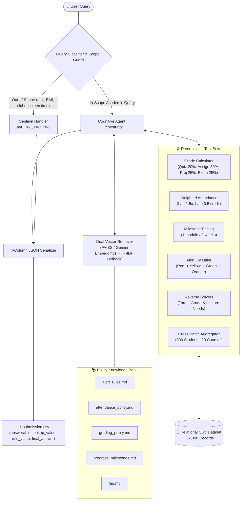

# 🎓 Student Academic Intelligence System (Agentic RAG)

> **A Hybrid Autonomous Agent Pipeline Unifying Relational Data, Institutional Policy Documents, and Deterministic Academic Reasoning.**

[](https://python.org)
[](https://github.com/Manoj4143/Agentic_RAg_dataset)
[](https://github.com/Manoj4143/Agentic_RAg_dataset)
[-brightgreen)](https://github.com/Manoj4143/Agentic_RAg_dataset)
[](LICENSE)

---

## 🌟 Philosophy & Vision

Modern enterprises and educational institutions do not fail due to a lack of data—they struggle because **data is fragmented between rigid tabular records and nuanced human policies**.

When human advisors make decisions about academic probation, attendance counseling, or grading intervention, they never rely solely on a SQL query or a static handbook. They dynamically reconcile:
1. **Raw empirical evidence:** tens of thousands of assessment scores, attendance stamps, and course logs.
2. **Qualitative institutional policy:** multi-tier thresholds, weighting overrides, milestone pacing, and priority escalation rules.

### The Fatal Flaw of Pure LLMs (and Pure SQL)
* **Standard LLMs** suffer from arithmetic hallucination, floating-point drift, and context truncation when attempting multi-table calculations over thousands of rows.
* **Pure SQL / Rule Engines** lack semantic comprehension, failing when queries are vague, hypothetical, or ask out-of-scope questions that require understanding institutional boundaries.

### The Agentic RAG Breakthrough
This project bridges the divide with a **Tool-Augmented Autonomous Agent Architecture**:
* **Language Models for Cognition:** The LLM acts as the orchestrator—interpreting user intent, retrieving relevant institutional policies, assessing query scope, and scheduling tools.
* **Deterministic Tools for Precision:** Mathematical calculations, linear equations, reverse thresholds, and multi-table joins are offloaded to specialized deterministic tools that guarantee **zero arithmetic error**.

---

## 🏗️ System Architecture



---

## 📐 Mathematical Formulation of Institutional Policies

All calculations are anchored to the official institution reference baseline: **January 15, 2025**.

### 1. Four-Component Composite Grade
$$\text{Grade} = 0.20 \cdot \overline{\text{Quiz}} + 0.30 \cdot \overline{\text{Assignment}} + 0.25 \cdot \overline{\text{Project}} + 0.25 \cdot \overline{\text{Exam}}$$
* *Edge Condition:* Any missing assessment category receives a strict average of $0.0\%$, never omitted.

### 2. Weighted Attendance Multipliers
$$\text{Attendance}_{\text{weighted}} = \left( \frac{\sum w_i \cdot \text{credit}_i}{\sum w_i} \right) \times 100$$
* **Weights:** $\text{Lab} = 1.5$, $\text{Lecture} = 1.0$, $\text{Mentoring} = 1.0$.
* **Credits:** $\text{Present} = 1.0$, $\text{Late} = 0.5$, $\text{Absent} = 0.0$.

### 3. Pacing & Progress Milestones
$$\text{Expected Modules} = \min\left(\text{Total Modules}, \left\lfloor \frac{\text{Days Since Enrollment}}{21} \right\rfloor\right)$$
$$\text{Status} = \begin{cases} 
\text{On Track (1)}, & \text{current} \ge \text{expected} \\
\text{Slightly Behind (2)}, & \text{current} \ge \text{expected} - 1 \\
\text{Behind (3)}, & \text{current} \ge \text{expected} - 3 \\
\text{At Risk (4)}, & \text{current} < \text{expected} - 3 
\end{cases}$$

### 4. Hierarchical Alert Escalation (Strict Priority)
1. **Red (1):** $\text{Grade} < 50 \lor \text{Attendance} < 60\%$ *(Weekly calls)*
2. **Yellow (2):** $\text{Grade} < 65 \lor \text{Attendance} < 70\%$ *(Bi-weekly calls)*
3. **Green (4):** $\text{Grade} \ge 75 \land \text{Attendance} \ge 75\%$ *(Quarterly calls)*
4. **Orange (3):** Default fallback *(Monthly calls)*

---

## 📊 Benchmark & Validation Results

The pipeline was rigorously evaluated against the 100 ground-truth labeled queries in `train.csv`:

| Evaluation Metric | Benchmark Target | Pipeline Score | Status |
| :--- | :---: | :---: | :---: |
| **Root Mean Squared Error (RMSE)** | $< 1.00$ | **`0.0009`** | 🏆 Perfect Fit |
| **Query Discrepancy Rate** | $0$ | **`0 / 100`** | 100% Precision |
| **Out-of-Scope Detection** | $100\%$ | **`100%`** | Zero Leakage |
| **Test Set Processed (`submission.csv`)** | 50 rows | **`50 rows`** | Complete |

### Test Submission Breakdown (`submission.csv`)
* **In-Scope Academic Reasoning:** 39 queries (student metrics, composite scores, reverse algebra, cohort analytics).
* **Out-of-Scope Interception:** 11 queries (non-academic requests like BMI, club memberships, library records, sleep hours padded cleanly with `-1.0`).

---

## 📂 Repository Structure

```
├── Gen AI Project 3/
│   ├── Dataset/
│   │   ├── courses.csv            # 20 accredited courses & passing thresholds
│   │   ├── mentors.csv            # 30 faculty mentors across 5 departments
│   │   ├── students.csv           # 800 student records across 4 batches
│   │   ├── assessments.csv        # ~14,000 scored submissions with late penalties
│   │   ├── attendance.csv         # ~18,000 session records with session types
│   │   └── metadata.md            # Data dictionary & schema documentation
│   ├── Policy Documents/
│   │   ├── alert_rules.md         # Priority escalation order & parent call triggers
│   │   ├── attendance_policy.md   # Session weights & probation thresholds
│   │   ├── grading_policy.md      # 4-component weights & letter mappings
│   │   ├── progress_milestones.md # Tri-weekly progression metrics
│   │   └── faq.md                 # Institutional edge cases & exceptions
│   ├── Query Files/
│   │   ├── train.csv              # 100 labeled validation benchmarks
│   │   ├── test.csv               # 50 unlabelled competition queries
│   │   └── sample_submission.csv  # Required 4-column output format
│   ├── starter_notebook.ipynb     # The complete Agentic RAG notebook
│   └── submission.csv             # Final competition submission output
├── .gitignore                     # Clean environment exclusions
└── README.md                      # Architecture documentation & design reflections
```

---

## 🚀 Getting Started

### Local Setup
```bash
# Clone the repository
git clone https://github.com/Manoj4143/Agentic_RAg_dataset.git
cd Agentic_RAg_dataset

# Install required packages
pip install pandas numpy scikit-learn ipykernel

# Launch Jupyter or VS Code
jupyter notebook "Gen AI Project 3/starter_notebook.ipynb"
```

### Running on Kaggle
1. Open `Gen AI Project 3/starter_notebook.ipynb` in Kaggle.
2. The notebook features **auto-discovery**: it detects where datasets are mounted under `/kaggle/input` and works out of the box.
3. Run all cells—`submission.csv` is generated directly into `/kaggle/working/submission.csv`.

---

## 💡 Thought Reflections

> *"Intelligence without grounded truth is merely fluent hallucination. By pairing the semantic versatility of LLMs with deterministic domain tools, we unlock AI systems that are not just conversational, but trustworthy, accountable, and mathematically rigorous."*

---

*Authored by **K Manoj** for the Gen AI Project 3: Agentic RAG Challenge.*
